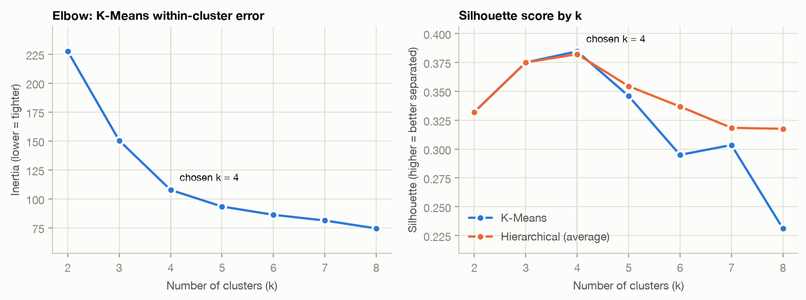
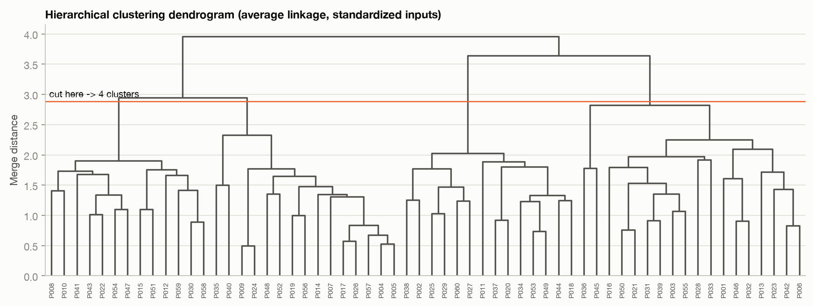
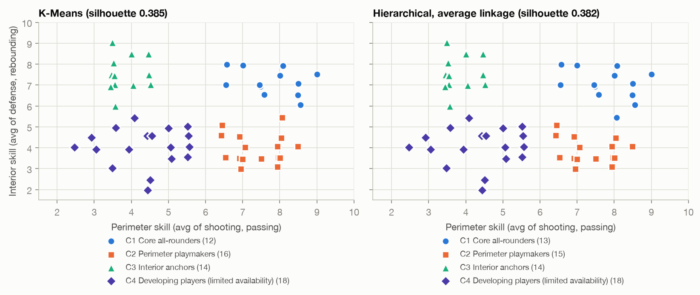
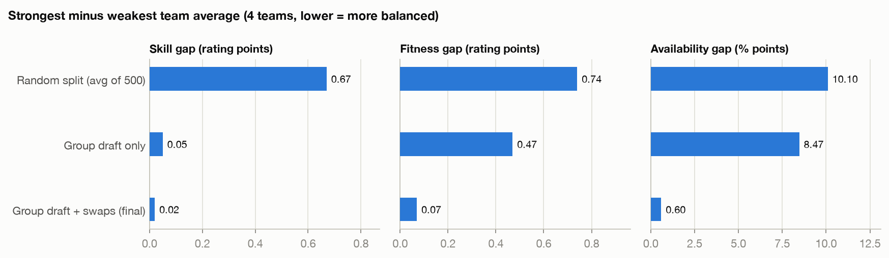

# Group 24: Sports Team Balancing with Unsupervised Clustering

**Scenario.** A coach wants to form balanced teams using player skills, preferred positions, fitness levels and availability.
**System question.** What natural groups appear in the data for sports team balancing, and how should they be interpreted?
**Primary algorithm:** K-Means. **Comparison algorithm:** Hierarchical (agglomerative) clustering, average linkage.

---

## Part 1: Understanding the dataset

| Item | In this project |
|---|---|
| Reference-only fields | `player_id`, `player_name`. They are used to display and join results, and never as inputs. |
| Analytical inputs | Clustering inputs: `shooting`, `passing`, `defense`, `rebounding`, `fitness_level`, `availability_pct`. Balancing input: `preferred_position`. |
| Target label | **None.** This is unsupervised learning, so there is no "correct" group to predict. |
| Generated output | Player group (cluster and archetype name), assignment certainty and the balanced **team** for each player. |
| Missing information | Height and age/experience, injury or medical status, game-day availability by date (we only have a season %), player chemistry and friend requests, and who rated each skill and when. |
| Concern (fairness) | Low availability often reflects work, school, caregiving or transport, not commitment. The model groups those players together as *Developing players (limited availability)*. That label must not be used to drop or bench them. The system's response is to spread them **evenly** across teams. *Privacy:* fitness is health-related data, so a real deployment should keep only IDs in the analysis file, limit who can see ratings and get player consent. |

Full field definitions are in [data_dictionary.md](data_dictionary.md).

## Part 2: Preparing and checking the dataset

- **Records:** 62 raw rows → **60 players** after removing 2 exact duplicate rows.
- **Features:** 6 numeric clustering inputs plus 1 categorical balancing input (7 inputs, within the 4–8 limit).
- **Missing values:** 5 cells across 5 players (`fitness_level` ×2, `shooting` ×1, `availability_pct` ×1, `preferred_position` ×1). They were imputed with the median for numbers and the most frequent value for position, and marked `was_imputed`.
- **Range check:** no out-of-range or non-numeric values in the training file.
- **Identifiers:** kept for display only. The KNIME Column Filter drops `player_name` before analysis.
- **Scaling:** `StandardScaler` (z-score) on all six numeric inputs before any distance calculation. Without it, availability (0–100) would count about 10× more than a 1–10 rating.

## Part 3: KNIME workflow

Node-by-node build instructions, settings and the numbers KNIME should reproduce are in [../knime/KNIME_workflow_guide.md](../knime/KNIME_workflow_guide.md):
CSV Reader → Duplicate Row Filter → Missing Value → Column Filter → Normalizer → k-Means → Cluster Assigner → Scatter Plot, plus a Hierarchical Clustering branch and Silhouette Coefficient nodes.

## Part 4: Python process

`train.py` (using `team_balancer.py`) loads the CSV with pandas and reports data quality. It then validates, de-duplicates and imputes, scales with `StandardScaler`, and tests k = 2–8. Next it fits `KMeans` and `AgglomerativeClustering`, compares their quality, names the groups and builds teams. Finally it saves `models/scaler.joblib`, `models/kmeans_model.joblib` and `models/metadata.json`.

### Choosing k

| k | 2 | 3 | **4** | 5 | 6 | 7 | 8 |
|---|---|---|---|---|---|---|---|
| K-Means silhouette | 0.332 | 0.375 | **0.385** | 0.346 | 0.295 | 0.303 | 0.231 |
| Hierarchical silhouette | 0.332 | 0.375 | **0.382** | 0.354 | 0.337 | 0.318 | 0.318 |
| K-Means inertia | 227.5 | 150.4 | **107.7** | 93.4 | 86.2 | 81.3 | 74.5 |

Silhouette peaks at **k = 4** for both methods, and the elbow bends there too: inertia drops by 77 and 43 up to k = 4, then by 14 or less for each extra cluster. The dendrogram also shows a clear gap where it is cut into four branches.

### The four groups (K-Means, averages in original units)

| Group | Players | Shooting | Passing | Defense | Rebounding | Fitness | Availability | Positions (not used for clustering) |
|---|---|---|---|---|---|---|---|---|
| **C1 Core all-rounders** | 12 | 8.1 | 7.4 | 7.7 | 6.7 | 7.8 | 88% | 4 G, 6 F, 2 C |
| **C2 Perimeter playmakers** | 16 | 7.2 | 7.6 | 4.3 | 3.6 | 6.7 | 84% | 15 G, 1 F |
| **C3 Interior anchors** | 14 | 3.7 | 3.9 | 7.2 | 7.9 | 6.6 | 77% | 1 G, 8 F, 5 C |
| **C4 Developing players (limited availability)** | 18 | 4.3 | 4.4 | 4.2 | 3.9 | 5.1 | 50% | 9 G, 7 F, 2 C |

### From groups to balanced teams

**The clusters are not the teams.** A cluster is a set of *similar* players, so using clusters as teams would produce the most unfair split possible. Instead, the groups are used to **stratify** the draft:

1. Take one group at a time, best `overall_skill` first.
2. Each player joins the team with the fewest players from their group, then the fewest players overall, then the fewest in their position, then the lowest total skill.
3. Swap players who share **both** group and position between teams whenever the swap brings team averages of skill, fitness and availability closer together. Such swaps never change a team's group mix, position mix or size.

Result for 4 teams of 15: every team has 3 C1, 4 C2, 3–4 C3 and 4–5 C4 players, and 7–8 guards, 5–6 forwards and 2–3 centers.

| Gap between strongest and weakest team | Skill (1–10) | Fitness (1–10) | Availability (%) |
|---|---|---|---|
| Random split (average of 500) | 0.67 | 0.74 | 10.1 |
| Group draft only | 0.05 | 0.47 | 8.5 |
| **Group draft + swaps (final)** | **0.02** | **0.07** | **0.6** |

## Part 5: Streamlit interface

`streamlit run app.py` provides the following:

- **Roster input:** use the sample roster, upload a CSV (a template download is provided) or type players into an editable table.
- **Validation:** an input-check panel lists rejected rows (out of range, text in number fields, unknown position, more than 2 inputs missing, duplicate IDs) and imputed values.
- **Model choice:** use the **trained model** (saved scaler and K-Means, so group meanings stay stable) or **re-fit** on the roster with automatic or manual k.
- **Output:** balanced teams with a short explanation, a team summary, group profiles with an interactive scatter plot, the K-Means vs hierarchical comparison and a CSV download.
- **Check one player:** enter (or leave blank) one player's inputs to see their group, certainty, an uncertainty warning and the team that needs them most.

## Part 6: Testing, comparison and reflection

### Test cases

`pytest` runs 42 automated tests, all passing. The table below shows the main cases (players T01–T11 are in `data/test_roster_edge_cases.csv`):

| Type | Input | Expected | Result |
|---|---|---|---|
| Normal | Sample roster (62 rows) | 60 usable, k = 4, even teams | ✅ 60 players, 4 groups. Team sizes, group counts and positions all within ±1. |
| Normal | Guard: 8, 8, 4, 3, fitness 7, 85% | Perimeter playmaker | ✅ C2 Perimeter playmakers, suggested team shown |
| Missing | T01: fitness blank | Accepted, imputed, flagged | ✅ Fitness set to 6.5 with a warning. C2, certainty 0.80. |
| Missing | T11: position blank | Accepted, imputed | ✅ Position set to Guard with a warning |
| Missing | T02: 3 of 6 inputs blank | Rejected | ✅ "3 of 6 inputs missing - too little information" |
| Boundary | T03: all ratings 1, availability 0 | Accepted | ✅ C4 Developing players |
| Boundary | T04: all ratings 10, availability 100 | Accepted | ✅ C1 Core all-rounders |
| Invalid | T05 shooting 11, T06 availability −5 | Rejected | ✅ "outside 1-10" / "outside 0-100" |
| Invalid | T07 "Point Guard", T08 passing "eight" | Rejected | ✅ "not one of [Guard, Forward, Center]" / "not a number" |
| Invalid | Duplicate T03 row, lowercase "forward" | Duplicate removed, case fixed | ✅ |
| Uncertain | T09: 7, 8, 5, 6, fitness 8, 85% | Flagged | ✅ Certainty **0.04** (< 0.15). Almost equally close to C1 and C2. The app warns that a coach should decide. |
| Too many teams | 13 teams for 60 players | Refused | ✅ "at most 12 teams of 5+ players" |

### Comparison of the two algorithms

| Measure | K-Means | Hierarchical (average) |
|---|---|---|
| Silhouette (higher better) | **0.385** | 0.382 |
| Davies–Bouldin (lower better) | **0.911** | 0.917 |
| Calinski–Harabasz (higher better) | **43.70** | 43.53 |
| Cluster sizes | 12 / 16 / 14 / 18 | 13 / 15 / 14 / 18 |
| Same result on re-run | ARI 0.96 over 20 random seeds | Always (deterministic) |
| Team skill gap, 4 teams | **0.017** | 0.033 |
| Places a new player without refitting | **Yes** (nearest centroid) | No |

The methods agree on **59 of 60 players** (adjusted Rand index 0.958). The one player they disagree on, P015, is also one of only two players K-Means flags as uncertain. In other words, the disagreement happens exactly where the data is ambiguous.

### Critical-thinking questions

**1. How should the number of clusters be selected?**
Use several kinds of evidence, not one number:
- the silhouette peak and the elbow in inertia (both at k = 4 here);
- a visible gap in the dendrogram;
- stability: re-running with different seeds gives nearly the same groups (ARI 0.96);
- usefulness: every group must mean something to a coach, and each must have at least as many players as there are teams, so every team can get one.

Do **not** set k equal to the number of teams. Groups are player *types*, and teams are built *from* them.

**2. Which characteristics make each discovered group meaningfully different?**
- *Perimeter vs interior skill* separates C2 (shooting and passing about 7.4, rebounding 3.6) from C3 (defense and rebounding about 7.5, shooting 3.7).
- *Overall level* separates C1 (high in everything, fitness 7.8) from C4 (about 4 in everything).
- *Availability* is the strongest single marker of C4: 50% vs 77–88% for the others.

Positions were **not** used for clustering, yet C2 is 94% guards and C3 is 93% forwards or centers. That suggests the groups reflect real basketball roles rather than noise.

**3. What should happen if the cluster assignments change after the data is updated?**
- **During a season**, keep the saved scaler and model and use them to *place* new or re-rated players. Group meanings then stay fixed, and existing teams are not reshuffled; a new player simply joins the team that needs their group and position most.
- **At planned checkpoints** (for example, a new season), re-train, compare old and new labels with the adjusted Rand index and match group numbers by overlap so the names carry over.
- **Review players who changed group** by hand, starting with those flagged uncertain, since they are the most likely to flip.
- **Record the model version and training date** (`metadata.json`) so any team list can be traced back to the model that produced it.

### Interpretation

The roster contains four natural player types: core all-rounders, perimeter playmakers, interior anchors, and developing players with limited availability. Both algorithms find almost the same four groups. K-Means is marginally better on every quality measure, but the differences (for example, silhouette 0.385 vs 0.382) are too small to matter. We keep K-Means as the primary method for practical reasons: it is fast, and its saved centroids can place a new player instantly, which the app needs. Hierarchical clustering remains useful for choosing k through the dendrogram.

The answer to the system question is therefore that the groups describe **what kind of player** someone is, and they are most useful as a guide for **spreading each kind evenly**. Drafting by group and then swapping like-for-like players produced four teams whose average skill differs by only 0.02 points (random teams: 0.67). Each team also has the same mix of player types and positions.

A silhouette of 0.385 means the groups are real but **overlap at the edges**. Players near a boundary (certainty below 0.15) are flagged rather than silently assigned.

### Limitations

- **Synthetic data.** The roster was generated with four planted profiles, so real ratings will be noisier and the groups less clear. The results demonstrate the method, not real players.
- **Small sample.** With 60 players, a single player can change group between methods, and cluster shapes would shift with a different roster.
- **Subjective inputs.** Skill ratings are one coach's opinion on a coarse 1–10 integer scale. Rater bias carries straight into the groups.
- **Equal weighting.** After scaling, availability counts as much as shooting. A coach may want different weights.
- **K-Means assumptions.** It assumes roughly round, similarly sized groups and Euclidean distance.
- **Simple imputation.** Filling a blank position with the most common value gave player P053, an Interior anchor, the position "Guard". A coach should confirm imputed values, or the group's most common position could be used instead.
- **What "balanced" leaves out.** Balance is measured by team averages only. It ignores height, experience, injuries, chemistry, leadership and week-to-week attendance.
- **KNIME vs Python.** KNIME's single random start and sample standard deviation can give slightly different numbers. The guide explains how to check them.
